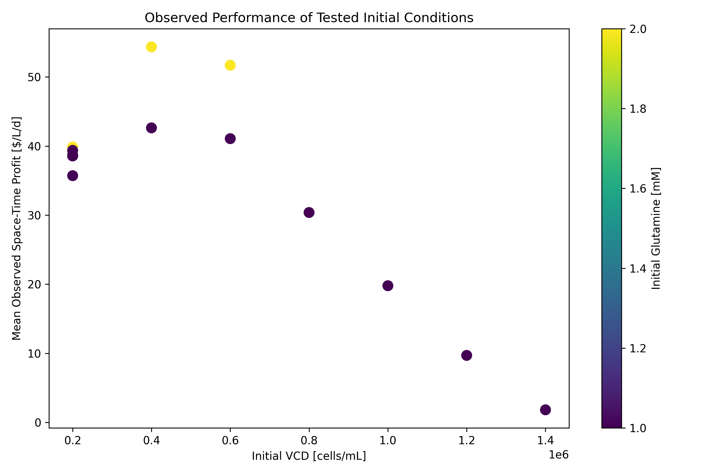
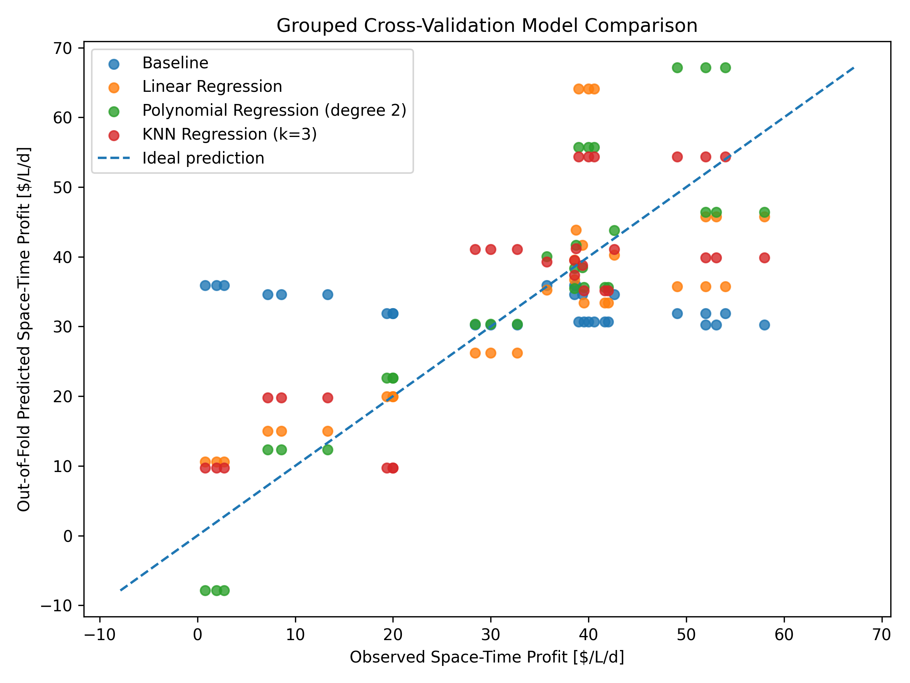
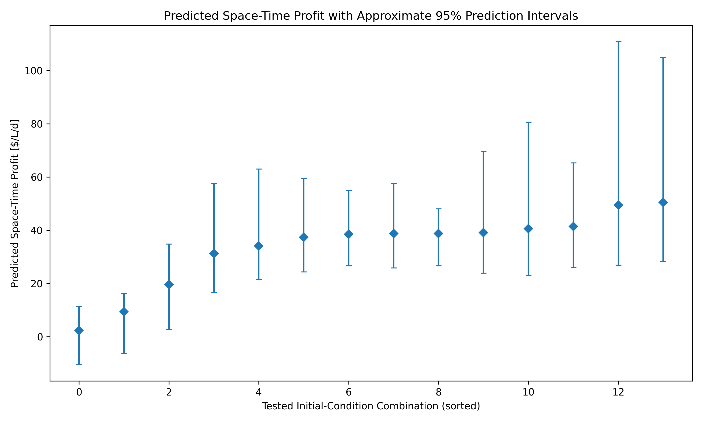

# Analyzing Bioreactor Data to Optimize Monoclonal Antibody Production
## About
#### Analyzes bioreactor batch datasets and compares regression models to determine conditions that maximize the space-time profit for monoclonal antibody production. 

This program analyzes 30 monoclonal antibody production batches to determine the best combination of factors to produce the most antibodies at the lowest cost. Since maximizing antibody concentration alone doesn't necessarily maximize profit, the model considers initial glucose and glutamine concentrations, viable cell densities and harvest time, which affect production costs. It compares initial conditions to determine the optimal starting conditions. Different regression models are also used to fit the best-performing data to estimate the most profitable conditions. 

### Highlights
- Evaluated the effects of initial culture conditions on space-time profit and antibody yields. 
- Compared linear, polynomial and other regression models using grouped cross-validation
- Optimized antibody production conditions using machine learning model predictions and reviewed results in tables and figures. 
- Identified model limitations given the provided conditions and aimed to improve them through optimization.   

### Environment
- Python 3.9.6
- Matplotlib 3.9.4 
- pandas 2.3.3 
- scikit-learn 1.6.1
- NumPy 2.0.2

## Code Design
### Data Preparation
This program analyzes data from thirty different antibody production batches to evaluate the effect of harvest time and initial conditions on the production economics. These batches were selected to give a broader range of possible initial process conditions, to see which conditions would be favoured in lieu of others. While there are different glucose and glutamine levels throughout the datasets, the fact that the majority of datasets have glucose concentrations of 5 mM and 2mM may potentially skew the data in favour of those conditions. The code aims to test different combinations of initial conditions and compare the results using regression models. The program loads the initial conditions from a saved dataset, verifies that the required columns are present and that the thirty batch files exists, and matches each batch with its corresponding initial condition information. This ensures that the correct main starting conditions are associated with the proper batches before the calculations are executed by the program.

It then uses a function to evaluate the best potential harvest times for each batch, records the production and economic results, and collects the harvest time with the highest observed space-time profit combining them into a single dataset. This is an important step as each batches may perform the best at different harvest times meaning the most profitable harvest might not be at the same time as the maximum concentration. Space-time profit considers both the generated profit and the time required to obtain the desired antibody concentration, including downtime in between batches. This ensures economic performance of different harvest-times can be compared on a consistent basis. The program separates the functions and classes into different files to organize the calculations and keep the main script focused on the overall workflow. After the optimized batch results are combined into a dataset, the code groups the batches into their initial glucose, glutamine and viable cell density (VCD) values. It compares the batches that began with the same set of combination conditions and calculates the average antibody concentration and profit, the maximum profit obaserved, as well as the space-time yield. These results are saved to a table to help compare how different starting conditions are associated with profitability and production.

### Regression Models and Validation
This program uses three initial conditions as input features and space-time profit as the target prediction variable, and uses that data to compare four regression models. The dummy regression predicts a simple baseline to which the other models are compared. Then linear, polynomial and KNN regression models were contemplated to asses which best fits the data. Each model provides a different representation of the data, as production outcomes may not be strictly linear between initial conditions, but can also be nonlinear. By looking at different model types, it helps determine the most accurate predictions for the combination of production factors.

Cross-validation is used to evaluate the model performance. The code groups all the same initial condition combinations together to reduce the risk of similar observations appearing in both the training and data validation sets. The program is trained on these groups and assesses predictions on held-out groups, whike repeating this process across multiple folds. From the cross-validation data, out of fold predictions are generated, which means each observation is predicted by a model taht did not train on its groups. The two main metrics used to evaluate the data were the root mean squared error (RMSE), which measures the typical scale of prediction error and the coefficient of determination (R^2), which measures the predictive performance relative to a mean reference. The comparison of the mean validation RMSE and the standard deviation helps asses how well the model predicts data that it hasnt trained on.

### Prediction Intervals and Optimization
The code uses the best selected model to predict the antibody concentration and harvest time, generating out-of-fold predictions for these two targets. The program then calculates residuals by comparing the observed values with the generated predictions. It then samples the residuals to simulate a range of possible productions outcomes and estimate the uincertainty of each one. The economics are considered as the code calculates the culture cost for each parameter, the culture value based on antibody production, the space-time profits and yields, which account for the garvest time and downwimte. The median estimates are calculated along with 95% prediction intervals from simulations to rank the combinations in terms of their space-time profits. This method identifies the recommended starting conditions and identifies the most promising tested combination of starting material costs, antibody production and process duration. The code creates figures to further analyze the datasets and exports files that contain the batch results, the model comparisons and all of the predicted outcomes. These tables and figures present the recommended conditions and economic performance, making the results easier to interpret and compare.

## Data Analysis

### Observed Production Performance
The initial batch conditions are important to consider, as they are the starting environment for cell growth and antibody production. By having a lot of replicate starting conditions, this helps demonstrate the variation in production outcomes, even when the starting conditions are the same. In this case the focus was put on batches that had a 5 mM glucose concentration, with a few batches with different starting conditions, to discern how they influence the production process compared to other batches with different concentrations. The full dataset contained 1,029 batches, which represented 343 unique initial condition combinations, with three replicates each. The evaluated batches were analyzed and ranked by observed space-time profit, so not every possible initial-condition combination could be evaluated. Although there are some limitations to this, the chosen datasets may not represent the full scope of possible production behaviors. As was previously discussed, each batch was evaluated at a different harvest time, and the ones with the highest observed space-time profits were selected. As shown in Table 1, batches 26, 28, and 25 yielded the best results, having space-time profits of $58, $54, and $53, respectively.

**Table 1.** Top Batches

|Time [h]|Glucose [mM]|Glutamine [mM]|Lactate [mM]|Ammonia [mM]|VCD [cells/mL]|TCD [cells/mL]|mAb [mg/L]|Harvest Time [d]  |Culture Cost [$/L]|Culture Value [$/L]|Profit [$/L]|Space-Time Profit [$/L/d]|Space-Time Yield [mg/L/d]|Batch ID|
|--------|------------|--------------|------------|------------|--------------|--------------|----------|------------------|------------------|-------------------|------------|-------------------------|-------------------------|--------|
|96.0    |5.0         |2.0           |2.03        |0.74        |400000.0      |539114.75     |0.58      |4.0               |290.0             |580.0              |290.0       |58.0                     |0.11599999999999999      |26      |
|56.0    |5.0         |2.0           |2.18        |0.37        |600000.0      |747183.95     |0.57      |2.3333333333333335|390.0             |570.0              |180.0       |54.0                     |0.17099999999999999      |28      |
|80.0    |5.0         |2.0           |1.53        |0.5         |400000.0      |569799.22     |0.52      |3.3333333333333335|290.0             |520.0              |230.0       |53.07692307692307        |0.11999999999999998      |25      |
|96.0    |5.0         |2.0           |3.6         |0.55        |600000.0      |911268.41     |0.65      |4.0               |390.0             |650.0              |260.0       |52.0                     |0.13                     |29      |
|96.0    |5.0         |2.0           |1.85        |0.5         |400000.0      |524223.05     |0.55      |4.0               |290.0             |550.0              |260.0       |52.0                     |0.11000000000000001      |27      |
|152.0   |5.0         |2.0           |4.78        |0.8         |600000.0      |837395.95     |0.75      |6.333333333333333 |390.0             |750.0              |360.0       |49.09090909090909        |0.10227272727272728      |30      |
|128.0   |5.0         |1.0           |1.61        |0.35        |400000.0      |487988.49     |0.54      |5.333333333333333 |270.0             |540.0              |270.0       |42.631578947368425       |0.08526315789473685      |6       |
|96.0    |5.0         |1.0           |2.12        |0.26        |600000.0      |755671.29     |0.58      |4.0               |370.0             |580.0              |210.0       |42.0                     |0.11599999999999999      |7       |
|120.0   |5.0         |1.0           |2.98        |0.33        |600000.0      |851617.54     |0.62      |5.0               |370.0             |620.0              |250.0       |41.666666666666664       |0.10333333333333333      |9       |
|112.0   |5.0         |2.0           |0.55        |0.6         |200000.0      |258858.82     |0.42      |4.666666666666667 |190.0             |420.0              |230.0       |40.588235294117645       |0.07411764705882352      |22      |

Each of these batches uses 5 mM of glucose and 2 mM of glutamine but have different variable cell densities. Batch 28 had a shorter selected harvest time than batch 26, which could contribute to its strong space-time performance. Although longer culture durations can be seen to generate a greater total profit per liter, shorter cultivation periods generally result in higher space-time profit because profit is generated in fewer days. These results are a culmination of the best batches, though they are not necessarily the best conditions predicted by the model.

### Impact of Initial Conditions on Economics
While it is important to select the process that yields the highest antibody concentration, the harvest time and other factors are also important to consider. This dataset investigates different initial glucose, glutamine, and VCD values. These conditions are important predictors, as they support cell growth and antibody production, as well as contribute to the culture cost under the project's cost equation. Having higher nutrient conditions can increase the cell growth and antibody production but comes at the cost of more expensive initial culture costs. So the most profitable conditions are not always the conditions with the highest nutrient and antibody concentrations. As shown in Table 2, for conditions having 5 mM glucose and 1 mM glutamine, the mean space-time profit decreases as the VCD increases. For example, a VCD of 400 000 cells/mL has a space-time profit of 42.63 $$/L/d, while one with a VCD of 1 400 000 cells/mL has one of 1.82 $/L/d, which is drastically lower. The highest observed space-time profits occurred at initial VCD values between 400,000 and 600,000 cells/mL, suggesting this range was the most promising within the experimental dataset. A condition can have a high space-time yield without necessarily having the highest space-time profit.

**Table 2.** Condition Comparison

|Glucose [mM]|Glutamine [mM]|VCD [cells/mL]|Batch_Count|Mean_mAb_mg_L|SD_mAb_mg_L|Mean_Space_Time_Profit|SD_Space_Time_Profit|Maximum_Space_Time_Profit|Mean_Space_Time_Yield|
|------------|--------------|--------------|-----------|-------------|-----------|----------------------|--------------------|-------------------------|---------------------|
|5.0         |1.0           |400000.0      |1          |0.54         |           |42.631578947368425    |                    |42.631578947368425       |0.08526315789473685  |
|5.0         |1.0           |600000.0      |3          |0.62         |0.040000000000000036|41.07070707070707     |1.3313805718575276  |42.0                     |0.10311111111111111  |
|5.0         |1.0           |800000.0      |3          |0.6633333333333333|0.0416333199893226|30.382775119617225    |2.1784789354702787  |32.72727272727273        |0.10585825358851675  |
|5.0         |1.0           |1000000.0     |3          |0.7233333333333333|0.04163331998932271|19.78494623655914     |0.3724840446384679  |20.0                     |0.09698156682027649  |
|5.0         |1.0           |1200000.0     |3          |0.75         |0.034641016151377574|9.701587301587303     |3.21906640362698    |13.333333333333334       |0.09322116402116402  |
|5.0         |1.0           |1400000.0     |3          |0.79         |0.010000000000000009|1.8244227168712295    |0.9756299998383476  |2.7272727272727275       |0.07382671104639069  |
|5.0         |2.0           |200000.0      |3          |0.4066666666666667|0.05131601439446886|39.86274509803922     |0.8029645188016973  |40.588235294117645       |0.07637254901960784  |
|5.0         |2.0           |400000.0      |3          |0.5499999999999999|0.029999999999999943|54.35897435897436     |3.1988656766668107  |58.0                     |0.11533333333333333  |
|5.0         |2.0           |600000.0      |3          |0.6566666666666666|0.09018499505645793|51.696969696969695    |2.4685347702322766  |54.0                     |0.13442424242424242  |
|10.0        |1.0           |200000.0      |1          |0.62         |           |38.70967741935484     |                    |38.70967741935484        |0.06                 |
|15.0        |1.0           |200000.0      |1          |0.69         |           |39.375                |                    |39.375                   |0.0646875            |
|20.0        |1.0           |200000.0      |1          |0.59         |           |38.57142857142857     |                    |38.57142857142857        |0.08428571428571428  |
|25.0        |1.0           |200000.0      |1          |0.64         |           |38.57142857142857     |                    |38.57142857142857        |0.09142857142857143  |
|30.0        |1.0           |200000.0      |1          |0.67         |           |35.714285714285715    |                    |35.714285714285715       |0.09571428571428572  |

This is because the space-time yield only considers antibody production in relation to the total production time, whereas the space-time profit accounts for the initial culture cost as well. So a condition that produces more antibody cells per day may not be as profitable if it requires a much higher starting nutrient level. However, this relationship is not necessarily linear or consistent across the nutrient data. These are trends observed in the tested data but don't provide proof that changing the VCD or nutrient concentrations is directly responsible for the changes. Some initial condition combinations only have one batch, while others have more, and groups with fewer batches provide weaker evidence about typical performance. Figure 1 provides a visual comparison of mean space-time profit across the tested initial conditions. It shows that the highest profits generally occur near the moderate initial VCD value, around 400000 - 600000 cells/mL, which supports the trends observed in table 2. Albeit, the relationship varies depending on the initial nutrient content. Having higher VCD values may increase the initial number of productive cells but also increase the culture costs.

**Figure 1.** Initial Condition Performance

### Regression Model Evaluation
To observe any non-linear relationships in the data, different regression models were used to estimate how initial conditions relate to space-time profit. In this case the predictors are the initial glucose, glutamine, and VCD concentrations, and the target is the space-time profit. The data is split into five folds for model comparisons, and batches with identical initial condition combinations are kept together in the same fold. This reduces the risk of having the same starting conditions represented in both training and validation datasets, meaning there is no data leakage. It provides a more realistic evaluation of how well the regression models can predict the space-time profits for combinations that were not included on the training fold. The three predictors were chosen as they represented the controllable initial conditions that influence the cell growth, metabolism, and production. Since optimizing the economic performance was the goal as well as the antibody concentration, space-time profit was selected as the target.

**Figure 2.** Model Comparison

In figure 2, baseline, linear, polynomial, and k-nearest neighbor regressions were used to determine the best-fitting model. Linear regression provided a simple comparison, while polynomial regression captured any potential nonlinear relationships between the initial conditions and the space-time profit. K-nearest neighbors provided another nonlinear alternative to compare with the other regressions. The horizontal axis displays the observed space-time profit, and the vertical shows the out-of-fold predictions. The points closest to the ideal predictions line indicate model predictions closer to the observed values. The input variables were standardized to prevent VCD, which has a much larger numerical scale than glucose and glutamine, which would dominate the distance-based calculations of the KNN model without this standardization. The KNN regression uses distance weighting, giving a greater influence to observations with more similar initial conditions.

**Table 3.** Model Comparison

|Model|OOF R2|OOF RMSE|Mean Fold RMSE|SD Fold RMSE|
|-----|------|--------|--------------|------------|
|Polynomial Regression (degree 2)|0.7320160476608175|8.529527051825612|7.85876160080813|3.7068682586329804|
|KNN Regression (k=3)|0.6781830940267299|9.34705900981689|8.972070369249288|2.930329636371572|
|Linear Regression|0.5824333612316674|10.647151990771926|9.502339896310223|5.369751159223952|
|Baseline|-0.16203954400517828|17.761556045663813|17.165903962041874|5.099585072485305|

The mean RMSE and R^2 values were calculated, a lower RMSE value indicating smaller typical prediction error and a higher R^2 indicating a better agreement with observed variation. Based on the results displayed in Table 3, the second-degree polynomial performed the best among the regression model candidates. The second-degree polynomial was selected due to its squared and interaction terms that allow it to represent more complex relationships between initial conditions than the linear regression model, while avoiding the overcomplexity of higher-degree models. This regression model had the lowest mean RMSE of 8.35 and the highest pooled R^2 of 0.73. However, the polynomial model still makes substantial errors for some observations. It also produces negative predictions for certain observations, which are physically unrealistic and illustrate the limitations of applying this regression to a small dataset. This model is useful for comparing candidate conditions, but its predictions should not be treated as exact outcomes.

### Prediction Uncertainty
Once the model best representing the data was chosen, in this case a second-degree polynomial regression, the program evaluated the tested initial condition combinations and ranked them according to their space-time profits. This model-based ranking of the tested conditions is not an extensive search of every possible glucose, glutamine, and VCD combination. As displayed in Table 4, the highest ranked prediction conditions were initial glucose and glutamine concentrations of 5 mM and 2 mM, with an initial VCD of 600 000 cells/mL. These results are very close to the second-ranked conditions with the same glucose and glutamine level but with a VCD of 400 000 cells/mL. Both best-ranked conditions have space-time profits of $50.46 and $49.38, respectively. The highest-ranked model also predicted a harvest time of about 99.7 hours, demonstrating that the model considers the duration of the antibody production while evaluating process profitability. Harvesting preemptively may limit antibody accumulation, but harvesting too late could increase the total production time, in turn reducing profits. Therefore, selecting an appropriate harvest time is essential for balancing antibody production with reactor productivity. The one-day downtime between the batches is also included in the space-time profit and yield calculations. This is important to note, as the objective of maximizing production efficiency included the duration of the process and not just the antibody concentration.
**Table 4.** Model Optimization

|Predicted Rank|Glucose [mM]|Glutamine [mM]|VCD [cells/mL]|Predicted mAb [mg/L]|Culture Cost [$/L]|Predicted Culture Value [$/L]|Culture Value PI Lower [$/L]|Culture Value PI Upper [$/L]|Predicted Harvest Time [d]|Harvest Time PI Lower [d]|Harvest Time PI Upper [d]|Predicted Space-Time Profit [$/L/d]|Profit PI Lower [$/L/d]|Profit PI Upper [$/L/d]|Predicted Space-Time Yield [mg/L/d]|Yield PI Lower [mg/L/d]|Yield PI Upper [mg/L/d]|
|--------------|------------|--------------|--------------|--------------------|------------------|-----------------------------|----------------------------|----------------------------|--------------------------|-------------------------|-------------------------|-----------------------------------|-----------------------|-----------------------|-----------------------------------|-----------------------|-----------------------|
|1             |5.0         |2.0           |600000.0      |0.6678018628040637  |390.0             |667.8018628040637            |536.4037234023639           |824.2733937095729           |4.153566416717912         |1.3794167979511487       |9.808674044327958        |50.461023792934114                 |28.165099434798258     |104.82789194118419     |0.12690530380268641                |0.0642472311005838     |0.24368344934827973    |
|2             |5.0         |2.0           |400000.0      |0.5450391437746791  |290.0             |545.0391437746791            |411.88970169393457          |699.7593720011437           |3.9886287114318297        |1.0053270321170409       |9.434584278493851        |49.379521855837226                 |26.82553995805129      |110.86630267544973     |0.11146217287790289                |0.054617734861081894   |0.22998314843911657    |
|3             |5.0         |1.0           |400000.0      |0.5843852681341188  |270.0             |584.3852681341189            |451.2358260533744           |739.1054963605835           |6.389989233433669         |3.615839614666905        |12.045096861043715       |41.369880654526014                 |26.006666372938454     |65.26326271557733      |0.07898611953806427                |0.04670409797318168    |0.11878057019976768    |
|4             |5.0         |2.0           |200000.0      |0.4195531654831081  |190.0             |419.5531654831081            |286.40372340236365          |574.2733937095727           |4.584940699488158         |1.6016390201733683       |10.03089626655018        |40.58116016709366                  |23.064977955448565     |80.6452473858604       |0.07759278647160597                |0.040289326313809194   |0.14333297513718377    |
|5             |5.0         |1.0           |600000.0      |0.6294416737347321  |370.0             |629.4416737347321            |511.9517570336608           |784.1619019611968           |5.493315795319978         |2.939271362381998        |10.939271362381998       |39.1351906434427                   |23.81350409408235      |69.63619975207054      |0.09863156914052071                |0.05480366997353359    |0.1635621992486547     |
|6             |15.0        |1.0           |200000.0      |0.6371860777901428  |270.0             |637.1860777901428            |505.7879383884429           |793.657608695652            |8.173843373080087         |5.399693754313324        |13.828951000690134       |38.79086936504375                  |26.556942172414704     |47.974829067337744     |0.06807867359063208                |0.044764568590995105   |0.08561155821773675    |
|7             |20.0        |1.0           |200000.0      |0.6598957255325469  |320.0             |659.895725532547             |528.497586130847            |816.3672564380562           |7.532933763382195         |4.758784144615431        |13.188041390992241       |38.71092670801046                  |25.833110564365956     |57.61455352646496      |0.07707063074919149                |0.04838731598155362    |0.10932720051454348    |
|8             |10.0        |1.0           |200000.0      |0.5978406730487782  |220.0             |597.8406730487782            |464.6912309680338           |752.5609012752429           |8.694089674495988         |5.7107879951811995       |14.14004524155801        |38.496364065797835                 |26.599318585724905     |55.001736473142664     |0.060515963261086034               |0.04113031875711941    |0.08581386616659464    |
|9             |25.0        |1.0           |200000.0      |0.6659696162759905  |370.0             |665.9696162759905            |532.8201741952461           |820.6898445024552           |6.562208784854286         |3.788059166087522        |12.217316412464331       |37.31202887850121                  |24.274506261130036     |59.579255969043125     |0.08711136721429001                |0.05226808592992564    |0.1304969406078468     |
|10            |30.0        |1.0           |200000.0      |0.6501538419833399  |420.0             |650.1538419833399            |518.7557025816401           |738.6548763177816           |5.26166843749636          |2.4875188187295967       |10.916776065106408       |34.034965416127385                 |21.54772037279223      |63.005735914951266     |0.1056615714830834                 |0.05679215206349126    |0.17023678334236908    |
|11            |5.0         |1.0           |800000.0      |0.673526122752204   |470.0             |673.5261227522041            |540.3766806714596           |828.2463509786686           |5.3578920505486956        |2.374590371233907        |10.803847617610717       |31.279366858300378                 |16.42332144506629      |57.415637649306724     |0.10766624683030493                |0.05916717659451476    |0.18097474075954587    |
|12            |5.0         |1.0           |1000000.0     |0.716638615186534   |570.0             |716.638615186534             |583.4891731057895           |871.3588434129987           |5.983717999119824         |3.20956838035306         |11.63882562672987        |19.558518112694113                 |2.6345293318658323     |34.817611593239334     |0.10116168667486541                |0.058669440565112245   |0.15769353879247322    |
|13            |5.0         |1.0           |1200000.0     |0.7587791510377222  |670.0             |758.7791510377222            |625.6297089569778           |845.5288826931193           |7.789097762129414         |5.01494814336265         |13.44420538973946        |9.284132941306776                  |-6.406776428407928     |16.08473946787481      |0.08720914651915401                |0.054253823150985335   |0.12005411342153277    |
|14            |5.0         |1.0           |1400000.0     |0.7981964276267244  |770.0             |798.1964276267244            |666.7982882250245           |954.6679585322337           |10.564879279029437        |7.790729660262674        |16.219986906639484       |2.308271538449205                  |-10.637918758870127    |11.259226359786593     |0.06873283298011616                |0.04789910401856666    |0.08837560750251307    |

Using the cost equation, the estimated initial cell culture cost was $390/L. It is determined directly from the selected initial conditions and doesn't have an internal prediction, as it is calculated from known input values. The difference between the two conditions is relatively small compared with the uncertainty in their predictions. As seen in table 5, the model predicts a median cell culture value of $667.80/L at harvest, with a 95% prediction interval of 536.40-824.27/L. The median predicted space-time profit is $50.46/L/d, with a 95% prediction interval of $28.17–104.83/L/d. The predicted space-time yield is 0.1269 mg/L/d, with a 95% prediction interval of 0.0642–0.2437 mg/L/d. These estimates account for uncertainty in the predicted production outcomes and harvest time through residual-based simulations. Model residuals are sampled and added to the predicted outcomes to generate possible production conditions, with the 2.5th and 97.5 percentiles used as lower and upper limits of the 95% prediction intervals.

**Table 5.** Economic Performance Summary

|Economic metric|Estimate|95% PI lower|95% PI upper|
|---------------|--------|------------|------------|
|Culture cost ($/L)|390.0   |            |            |
|Culture value ($/L)|667.8018628040637|536.4037234023639|824.2733937095729|
|Space-time profit ($/L/d)|50.461023792934114|28.165099434798258|104.82789194118419|
|Space-time yield (mg/L/d)|0.12690530380268641|0.0642472311005838|0.24368344934827973|

Each point on the uncertainty figure represents a predicted space-time profit for a candidate initial condition combination. The vertical error bars seen in the figure show approximate 95% prediction intervals. The prediction intervals for both are wide and overlap substantially, which suggests considerable uncertainty in the predicted space-time profits. The recommended conditions provide the highest predicted median space-time profit among the tested combinations; the uncertainty suggests the model doesn't provide strong enough evidence that one condition will consistently outperform the others. The overlap between prediction intervals indicates that the difference in predicted performance between the leading conditions might be substantiated relative to the uncertainty in the model.

**Figure 3.** Profit Prediction 

The best observed batch, 26, achieved a space-time profit of approximately $58/L/d, while the model-based recommendation had the highest predicted median space-time profit closer to $50.46/L/d. The predicted value being a little bit lower than the best individual observed result does not necessarily indicate a problem. The model estimates an expected performance based on patterns across the dataset, whereas batch 26 represents only one particular experimental result. Due to experimental variability, individual batches can sometimes perform better or worse than the model's experimental prediction. This is a good example of why it is useful to analyze both the observed results and the regression predictions when determining optimal process conditions.

This analysis was able to determine the optimal initial conditions and harvest-times when looking at multiple batches. Nonetheless, these are estimations, and there are still several things to consider when validating the results. Using only thirty batches restricts the amount of data available to train and validate the regression data. The number of uneven batches in this data is also a consideration. Some initial condition combinations have several experimental batches, while others only have one, which can make the comparison between conditions less reliable. In selecting second-degree polynomial regression, it does not necessarily mean that it predicts every batch accurately, as some predictions differ from observed results. Additionally, Figure 3 shows that the predicted profit intervals are broad and overlap, which makes it hard to confidently distinguish between the highest-ranked conditions. In order to address these limitations, further testing could be done on a larger dataset, comparing initial VCD values between the two optimal case values and running additional batches to determine whether the predicted profitability is repeatable.

